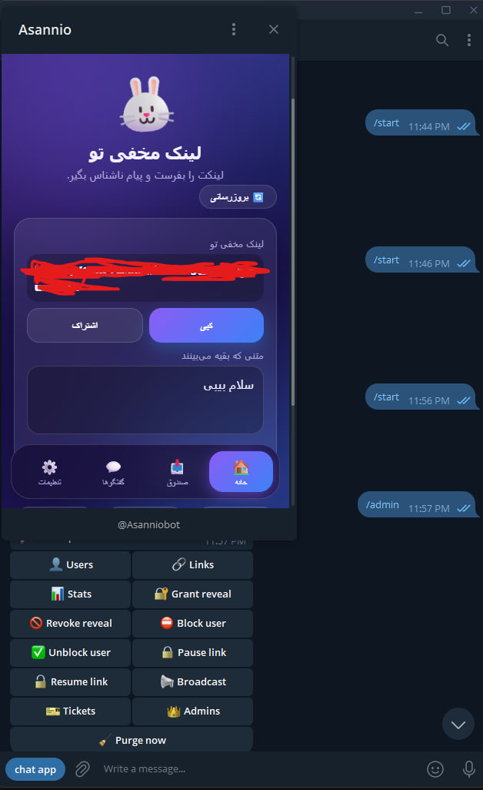

# Anonymous Bot + Admin Panel + Mini App

**Language / زبان:** [English](#english) · [فارسی](#فارسی)

---

## English

A Telegram anonymous-message bot that runs on **Cloudflare Workers** with a **D1** database. It comes with a full **Mini App** (inbox, chats, media, saved messages, themes, English/Persian UI) and a button-based **admin panel** with granular permissions, broadcasts, support tickets and a read-only monitor for the main admin.

### Screenshots

| Mini App settings | Mini App home, chat and admin panel |
|---|---|
|  |  |

### What the bot can do

**For every user**
- Create one personal anonymous link with a custom intro message. Share it anywhere.
- Receive anonymous messages in the **Inbox** and reply privately from **Chats**.
- Send and receive **text, photos, videos, voice messages, music and files** in both directions.
- Get a "Your message was seen" notice when the link owner opens a message.
- Save or pin important messages, and save media to Telegram Saved Messages.
- Pause or resume the personal link at any time.
- Switch between English and Persian, change the color theme and the avatar.
- Open a **Report** or **Reveal request** ticket from any chat to reach the admin.
- Turn new-message notifications on or off.

**For the link owner (inside the Mini App)**
- Browse all anonymous conversations in one place, each with its own chat.
- Switch between chats quickly from the chip bar at the top of a conversation.
- Block or unblock a sender.
- Reveal a sender's identity, but only if an admin granted the reveal permission. The app shows a username or display name, never the numeric ID.

**For admins (`/admin` in the bot)**
- **Users**: list users with their numeric IDs and their status, with one-tap Ban and Unban buttons.
- **Links**: list links and pause or resume them.
- **Stats**: totals for users, links, chats and messages.
- **Grant / Revoke reveal**: control who can see sender identities.
- **Block / Unblock user**.
- **Pause / Resume link**.
- **Broadcast**: write one announcement and send it to all users. The bot queues it and sends about 20 messages per minute to stay within limits and avoid freezing.
- **Tickets**: review reports and reveal requests, then approve or close them.
- **Admins** (main admin only): add an admin by ID and toggle their permissions one by one: users and bans, links, reveal identity, broadcast, tickets, stats. Remove admin rights at any time.
- **Purge now** (main admin only): delete all conversation messages immediately, after a confirmation. Users, links and settings stay.

**For the main admin only**
- Read-only **Monitor** of all conversations. Opening a chat here does not mark any message as seen, and senders are not notified.
- Full control of the admin panel, including managing other admins.

**Automatic behavior**
- Messages older than 20 days are deleted each day. A reminder is sent a few days before deletion so people can save what they need.
- Rate limits protect the bot: too many messages or actions in a short time get a short wait notice, with longer waits for repeated abuse.
- Broadcasts run from a cron job every minute, in small batches.

### Requirements
- A Cloudflare account (Workers and D1 work on the free plan).
- A Telegram bot token from @BotFather.

### Setup
1. **Create the D1 database**: Cloudflare dashboard → Storage & Databases → D1 → create `anon-bot-db`.
2. **Create the Worker**: Workers & Pages → Create Worker → name it `anon-bot`. Replace the code of `worker.js` with the file in this repository.
3. **Bind the database**: Worker → Settings → Bindings → D1 database, variable name `DB`, database `anon-bot-db`.
4. **Set variables and secrets** (Settings → Variables and Secrets):
   - `BOT_TOKEN` (Secret): token from @BotFather.
   - `WEBHOOK_SECRET` (Secret): a long random string you choose.
   - `ADMIN_ID`: the main admin's numeric Telegram ID.
   - `BOT_USERNAME`: bot username without `@`.
   - `MINIAPP_URL`: `https://<worker-name>.<subdomain>.workers.dev/app`.
   - `DEFAULT_LANG`: `en` or `fa`.
5. **Cron triggers** (Settings → Triggers → Cron Triggers):
   - `0 3 * * *` for the daily retention cleanup.
   - `* * * * *` for the broadcast queue.
6. **Deploy**, then register the webhook (replace the placeholders):
   ```
   https://api.telegram.org/bot<BOT_TOKEN>/setWebhook?url=https://<worker-url>/webhook&secret_token=<WEBHOOK_SECRET>
   ```
   You should see `"ok":true`.
7. In Telegram, send `/start` to the bot, then `/admin`.

### Database
Helper tables (`alex_anon_*`) are created automatically on first use. The core tables `users`, `links`, `threads` and `messages` must exist before the first run. Create them with your initial SQL if you start from an empty database.

### Security notes
- Mini App requests are verified with Telegram's `initData` HMAC signature.
- Webhook requests are checked with `WEBHOOK_SECRET`.
- Identity reveal is off by default and always logged.
- Never commit tokens or secrets. Keep this repository private.
- If a token was ever shared, revoke it with `/revoke` in @BotFather and use the new one.

### Credits
Made by **alex anderson**.

---

## فارسی

یک ربات پیام ناشناس تلگرام که روی **Cloudflare Workers** و دیتابیس **D1** اجرا می‌شود. این پروژه یک **مینی‌اپ** کامل (صندوق ورودی، گفتگوها، رسانه، پیام‌های ذخیره‌شده، قالب رنگی، رابط فارسی و انگلیسی) و یک **پنل ادمین** دکمه‌ای با دسترسی‌های جزئی، ارسال همگانی، تیکت پشتیبانی و نظارت فقط‌خواندنی برای ادمین اصلی دارد.

### تصاویر

| تنظیمات مینی‌اپ | صفحه اصلی مینی‌اپ، چت و پنل ادمین |
|---|---|
|  |  |

### ربات چه کارهایی می‌تواند انجام دهد؟

**برای همه کاربران**
- ساخت یک لینک ناشناس شخصی با متن معرفی دلخواه و اشتراک‌گذاری آن در هر جا.
- دریافت پیام‌های ناشناس در **صندوق ورودی** و پاسخ خصوصی از بخش **گفتگوها**.
- ارسال و دریافت **متن، عکس، ویدیو، ویس، موزیک و فایل** در هر دو جهت.
- دریافت اعلان «پیامت دیده شد» وقتی صاحب لینک پیام را باز کند.
- ذخیره یا سنجاق‌کردن پیام‌های مهم و ذخیره رسانه‌ها در Saved Messages تلگرام.
- توقف یا فعال‌سازی لینک در هر زمان.
- تغییر زبان بین فارسی و انگلیسی، تغییر قالب رنگی و آواتار.
- ارسال **گزارش** یا **درخواست خواندن هویت** از داخل هر گفتگو به ادمین.
- روشن یا خاموش کردن اعلان پیام‌های جدید.

**برای صاحب لینک (داخل مینی‌اپ)**
- دیدن همه گفتگوهای ناشناس در یک جا و باز کردن هر کدام به‌صورت جدا.
- جابه‌جایی سریع بین گفتگوها از نوار بالای هر چت.
- مسدود یا آزاد کردن یک فرستنده.
- افشای هویت فرستنده، فقط اگر ادمین این دسترسی را داده باشد. برنامه یوزرنیم یا نام نمایشی را نشان می‌دهد و هرگز آیدی عددی را نشان نمی‌دهد.

**برای ادمین‌ها (`/admin` در ربات)**
- **Users**: لیست کاربران با آیدی عددی و وضعیتشان، همراه با دکمه‌های Ban و Unban.
- **Links**: لیست لینک‌ها و توقف یا فعال‌سازی آن‌ها.
- **Stats**: آمار کل کاربران، لینک‌ها، گفتگوها و پیام‌ها.
- **Grant / Revoke reveal**: مشخص کردن اینکه چه کسی هویت فرستنده‌ها را ببیند.
- **Block / Unblock user**: مسدود و آزاد کردن کاربر.
- **Pause / Resume link**: توقف و فعال‌سازی لینک.
- **Broadcast**: نوشتن یک اطلاعیه و ارسال آن به همه کاربران. ربات آن را در صف می‌گذارد و حدود ۲۰ پیام در دقیقه می‌فرستد تا ربات هنگ نکند و در محدودیت‌ها نماند.
- **Tickets**: بررسی گزارش‌ها و درخواست‌های خواندن هویت، سپس تأیید یا بستن آن‌ها.
- **Admins** (فقط ادمین اصلی): افزودن ادمین با آیدی و روشن یا خاموش کردن دسترسی‌ها یکی‌یکی: کاربران و بن، لینک‌ها، افشای هویت، ارسال همگانی، تیکت‌ها و آمار. حذف ادمین هم در هر زمان ممکن است.
- **Purge now** (فقط ادمین اصلی): حذف فوری همه پیام‌های گفتگوها پس از تأیید. کاربران، لینک‌ها و تنظیمات حفظ می‌شوند.

**فقط برای ادمین اصلی**
- **نظارت** فقط‌خواندنی روی همه گفتگوها. باز کردن گفتگو در این بخش هیچ پیامی را «دیده شده» نمی‌کند و به فرستنده اطلاعی داده نمی‌شود.
- کنترل کامل پنل ادمین از جمله مدیریت ادمین‌های دیگر.

**رفتار خودکار**
- پیام‌های بیش از ۲۰ روز هر روز حذف می‌شوند. چند روز قبل از حذف، اعلانی فرستاده می‌شود تا کاربران محتوای مهمشان را ذخیره کنند.
- محدودیت نرخ از ربات محافظت می‌کند: ارسال پیام یا درخواست زیاد در مدت کوتاه، با پیام انتظار کوتاه روبه‌رو می‌شود و تکرار آن زمان انتظار را بیشتر می‌کند.
- ارسال همگانی با Cron هر دقیقه و به‌صورت دسته‌ای اجرا می‌شود.

### نیازمندی‌ها
- حساب Cloudflare (Workers و D1 در پلن رایگان کار می‌کنند).
- توکن ربات از @BotFather.

### راه‌اندازی
1. **ساخت دیتابیس D1**: داشبورد Cloudflare → Storage & Databases → D1 → ساخت `anon-bot-db`.
2. **ساخت Worker**: Workers & Pages → Create Worker → نام `anon-bot`. محتوای `worker.js` را با فایل این ریپازیتوری جایگزین کنید.
3. **اتصال دیتابیس**: Worker → Settings → Bindings → D1 database با نام متغیر `DB` و دیتابیس `anon-bot-db`.
4. **متغیرها و سکرت‌ها** (Settings → Variables and Secrets):
   - `BOT_TOKEN` (Secret): توکن از @BotFather.
   - `WEBHOOK_SECRET` (Secret): یک رشته تصادفی بلند که خودتان می‌سازید.
   - `ADMIN_ID`: آیدی عددی ادمین اصلی.
   - `BOT_USERNAME`: یوزرنیم ربات بدون `@`.
   - `MINIAPP_URL`: `https://<نام-worker>.<subdomain>.workers.dev/app`.
   - `DEFAULT_LANG`: `en` یا `fa`.
5. **تریگر Cron** (Settings → Triggers → Cron Triggers):
   - `0 3 * * *` برای پاک‌سازی روزانه.
   - `* * * * *` برای صف ارسال همگانی.
6. **Deploy** و سپس ثبت وبهوک (جای‌نگهدارها را پر کنید):
   ```
   https://api.telegram.org/bot<BOT_TOKEN>/setWebhook?url=https://<worker-url>/webhook&secret_token=<WEBHOOK_SECRET>
   ```
   باید `"ok":true` ببینید.
7. در تلگرام به ربات `/start` و سپس `/admin` بفرستید.

### دیتابیس
جدول‌های کمکی (`alex_anon_*`) هنگام اولین استفاده خودکار ساخته می‌شوند. جدول‌های اصلی `users`، `links`، `threads` و `messages` باید قبل از اولین اجرا وجود داشته باشند. اگر از دیتابیس خالی شروع می‌کنید، آن‌ها را با SQL راه‌اندازی اولیه بسازید.

### نکات امنیتی
- درخواست‌های مینی‌اپ با امضای HMAC و `initData` تلگرام بررسی می‌شوند.
- درخواست‌های وبهوک با `WEBHOOK_SECRET` بررسی می‌شوند.
- افشای هویت به‌صورت پیش‌فرض بسته است و هر افشا ثبت می‌شود.
- توکن و سکرت را هرگز در ریپازیتوری نگذارید و ریپو را خصوصی نگه دارید.
- اگر توکنی جایی فاش شد، با `/revoke` در @BotFather باطل کنید و توکن جدید بگیرید.

### سازنده
ساخته‌شده توسط **alex anderson**.
